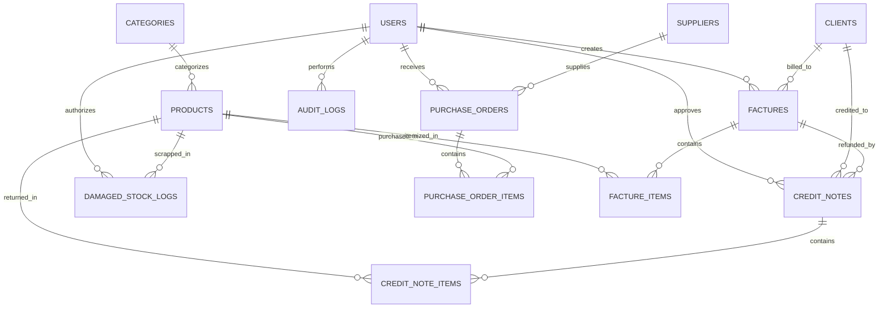

<div align="center">

# ⚡ FactureFlow

### Enterprise-Grade Inventory, POS, Facture (Invoice) & Purchase Order Management Platform

[](https://nextjs.org/)
[](https://www.typescriptlang.org/)
[](https://tailwindcss.com/)
[](https://supabase.com/)
[](https://github.com/pmndrs/zustand)
[](LICENSE)

<p align="center">
  A modern, high-performance SaaS platform inspired by Linear, Stripe, and Vercel for real-time inventory tracking, custom quantity stock adjustments, dynamic invoice editing, 19% TVA toggle controls, barcode point-of-sale (POS), supplier management & purchase orders (Factures d'Achat), automated weighted stock revaluation, official A4 invoicing, thermal receipts, role-based access control (RBAC), and enterprise financial intelligence.
</p>

[Key Features](#-key-features) • [Tech Stack](#-tech-stack) • [Quick Start](#-quick-start) • [RBAC & Demo Credentials](#-rbac--demo-credentials) • [Enterprise Dashboard](#-enterprise-dashboard--financial-analytics) • [Database Schema](#-database-schema) • [API Reference](#-api-reference)

</div>

---

## 🌟 Key Features

### 🛒 1. High-Speed POS & Facture Billing Engine
* **Split-View Interface:** Category tabs, live product search, and responsive catalog grid on the left; real-time reactive order cart on the right.
* **Barcode Scanner Support:** Camera stream barcode scanner, USB hardware scanner listener, and simulation presets.
* **Stock Safety Guard:** Real-time inventory validation preventing cart quantities from exceeding sellable stock (`quantity_sellable`).
* **Fixed 19% TVA with Customer Toggle Switch:** Dynamic toggle to include or exempt invoices from 19% TVA with automated real-time recalculation of subtotals and totals.
* **Full Past Invoice Editing:** Search catalog items, adjust line quantities, remove items, and edit previous factures with automatic stock delta reconciliation.
* **Dual Output Engine:** One-click clean **A4 Printable Invoices** (official B2B with tax ID/ICE/NIF/NIS) and **80mm Thermal Receipts** (retail counters) via `@media print`.

### 📦 2. Product & Inventory Management
* **Smart Stock Badges:** Dynamic visual indicators (🟢 In Stock, 🟠 Low Stock, 🔴 Out of Stock).
* **Custom Number Input Stock Adjuster:** Replaces fixed quick modifiers with a sleek number input supporting free additions/subtractions, live stock preview, Enter-to-apply, and actor audit logging.
* **Dynamic Category Selector:** Live creation of categories on the fly with the `+ Add New Category...` modal and instant dropdown sync.
* **Client-Side WebP Image Compressor:** HTML5 `<canvas>` compressor reducing product images below $< 200\text{ KB}$ with live compression statistics.
* **Stock Alert Center:** Compiles items requiring immediate supplier reorders.

### 🏭 3. Supplier Directory & Purchase Orders (Factures d'Achat)
* **Supplier Directory (`/suppliers`):**
  * Complete vendor directory tracking company name, contact person, phone, email, address, tax identifiers (**NIF**, **NIS**), and payment terms (Immediate, Net 30, Net 60, Cash on Delivery).
  * Quick-search, supplier modal registration, and integrated contact actions.
* **Purchase Orders Module (`/purchase-orders`):**
  * Create incoming purchase orders / vendor invoices with custom invoice references (`INV-ACHAT-XXXX`), vendor selection, and dynamic line items.
  * Direct product picker with editable purchase cost and quantity inputs.
  * Automated order subtotal, tax, and grand total calculations.
* **Automated Stock Revaluation & Receiving Workflow:**
  * One-click **Receive Order** action transitions status from `draft` to `received`.
  * Automatically increments sellable stock quantities (`quantity_sellable + ordered_qty`).
  * Dynamically updates product cost price using weighted average cost recalculation:
    $$\text{New Cost} = \frac{(\text{Current Qty} \times \text{Current Cost}) + (\text{Received Qty} \times \text{Purchase Cost})}{\text{Current Qty} + \text{Received Qty}}$$
  * Records detailed entries in the immutable audit trail with before/after cost and quantity differentials.
* **Full Trilingual Localization (EN / FR / AR + RTL):** Complete interface translation with localized currency formatting and Right-to-Left (RTL) support.

### 📊 4. Enterprise Dashboard & Financial Intelligence
* **Timeframe View Selector (Daily | Monthly | Yearly):**
  * **Daily View:** Today’s gross revenue, completed orders count, average basket size, payment method breakdown (Cash, Card, Transfer, Cheque), and an **Hourly Sales Velocity Chart** displaying peak store traffic hours for staff scheduling.
  * **Monthly View:** Monthly turnover, total 19% TVA collected for tax reporting, total discounts applied, net profit margin, and **Month-over-Month (MoM) growth indicator** (+% vs last month).
  * **Yearly View:** Annual turnover, cumulative inventory cost vs. retail valuation, and historical Year-over-Year (YoY) charts from snapshots.
* **Inventory Valuation & Unrealized Profit Widget:** Displays total capital tied up in stock ($\sum \text{Qty} \times \text{Cost}$) vs. potential retail valuation ($\sum \text{Qty} \times \text{Price}$), highlighting unrealized profit margins.
* **Leaderboards:**
  * **Top-Selling Products Leaderboard:** Ranked by unit sales and net profit contributions.
  * **Top Categories Leaderboard:** Sales volume and revenue by category.
  * **Cashier & Staff Sales Leaderboard:** Performance tracking (orders processed, total revenue, average basket) strictly restricted to Managers and Admins.
* **Damaged Goods Loss Tracking:** Financial loss tracking of written-off damaged inventory.

### 🔄 5. Returns, Credit Notes (*Avoir*) & Damaged Goods
* **Credit Notes (*Avoir*):** Process returns tied directly to original invoice IDs (`AVR-2024-XXXX`).
* **Smart Stock Routing:** Route returned goods to **Sellable Stock** (`quantity_sellable + N`) or **Damaged Pool** (`quantity_damaged + N`).
* **Damaged Goods Write-Off Engine:** Deduct broken or expired inventory and compute net financial losses isolated from standard sales P&L.

### 🛡️ 6. Role-Based Access Control (RBAC) & Audit Trail
* **4 Distinct Role Tiers:**
  * **Admin:** Full unrestricted access to all modules, financial metrics, settings, user management, and system overrides.
  * **Manager:** Identical administrative capabilities for stock, sales, reports, supplier orders, and overrides.
  * **Cashier:** Sales and POS worker. Can create and process invoices; blocked from modifying stock quantities, viewing the Financial Dashboard, purchase orders, and accessing audit logs.
  * **Stocker (Warehouse Worker):** Can add/subtract stock, manage inventory quantities, receive purchase orders, and manage categories; blocked from POS sales, invoice creation, Financial Dashboard, and audit logs.
* **Immutable Audit Trail:** Real-time tracking of `CUSTOM_STOCK_ADJUST`, `PRICE_OVERRIDE`, `RECEIVE_PURCHASE_ORDER`, `APPROVE_RETURN`, `EDIT_PRODUCT_COST`, `WRITE_OFF_DAMAGED`, `CREATE_FACTURE`, capturing actor ID, timestamp, IP address, and JSON diffs of `old_values` vs `new_values`.

---

## 🛠️ Tech Stack

| Domain | Technology |
|---|---|
| **Framework** | [Next.js 14 (App Router)](https://nextjs.org/) |
| **Language** | [TypeScript](https://www.typescriptlang.org/) (Strict mode) |
| **Styling** | [Tailwind CSS](https://tailwindcss.com/) with Dark/Light mode |
| **Animations** | [Framer Motion](https://www.framer.com/motion/) |
| **Icons & UI** | [Lucide React](https://lucide.dev/), [Canvas Confetti](https://www.npmjs.com/package/canvas-confetti) |
| **State Management** | [Zustand](https://github.com/pmndrs/zustand) |
| **Charts & Analytics** | [Recharts](https://recharts.org/) |
| **Database** | [Supabase](https://supabase.com/) (PostgreSQL) with live synchronization |
| **Image Processing** | HTML5 `<canvas>` WebP client-side compressor |
| **Document Output** | Custom CSS `@media print` engine for A4 & 80mm thermal printers |
| **Internationalization** | Trilingual engine (English, French, Arabic with RTL support) |

---

## 🚀 Quick Start

### Prerequisites
- [Node.js](https://nodejs.org/) (v18.0.0 or higher)
- `npm` or `yarn` / `pnpm`

### Installation

```bash
# 1. Clone the repository
git clone https://github.com/SouL-Dev-exe/Facture_Flow.git
cd Facture_Flow

# 2. Install dependencies
npm install

# 3. Setup environment variables
cp .env.example .env

# 4. Run database migrations (Supabase SQL Editor)
# Execute supabase_schema.sql and supabase_suppliers_migration.sql

# 5. Start the development server
npm run dev
```

Open [http://localhost:3000](http://localhost:3000) in your browser.

---

## 🛡️ RBAC & Demo Credentials

Switch roles directly via the top header switcher bar or test security verification modals:

| Role | Primary Responsibility | Default User | Email | Password | PIN Code |
|---|---|---|---|---|---|
| **Admin** | System Overrides & Full Administration | SouL | `admin@factureflow.com` | `admin123` | `1111` |
| **Manager** | Store Management & Overrides | SouL1 | `manager@factureflow.com` | `manager123` | `2222` |
| **Cashier** | POS Sales & Customer Checkout | SouL2 | `cashier@factureflow.com` | `cashier123` | `3333` |
| **Stocker** | Warehouse & Inventory Stocking | SouL3 | `stocker@factureflow.com` | `stocker123` | `4444` |

---

## 🗄️ Database Schema

The application connects to Supabase PostgreSQL with real-time sync:



---

## 📡 API Reference

| Method | Endpoint | Description | Allowed Roles |
|---|---|---|---|
| `GET` / `POST` | `/api/products` | Catalog items and stock registration | `admin`, `manager`, `stocker` (POST blocked for `cashier`) |
| `PATCH` | `/api/products` | Custom quantity stock update or price edits | `admin`, `manager`, `stocker` (Blocked for `cashier`) |
| `GET` / `POST` | `/api/categories` | Fetch and create dynamic categories | `admin`, `manager`, `stocker` |
| `GET` / `POST` | `/api/suppliers` | List vendors and register new suppliers | `admin`, `manager`, `stocker` (POST blocked for `cashier`) |
| `GET` / `POST` | `/api/purchase-orders` | List purchase orders or create draft orders | `admin`, `manager`, `stocker` (POST blocked for `cashier`) |
| `PATCH` | `/api/purchase-orders/[id]` | Receive purchase order & revalue inventory cost | `admin`, `manager` |
| `DELETE` | `/api/purchase-orders/[id]` | Delete draft purchase order | `admin`, `manager` |
| `GET` / `POST` | `/api/factures` | List factures or execute checkout | `admin`, `manager`, `cashier` (POST blocked for `stocker`) |
| `PUT` | `/api/factures/[id]` | Full invoice item edit & 19% TVA recalculation | `admin`, `manager`, `cashier` (Blocked for `stocker`) |
| `GET` / `POST` | `/api/credit-notes` | Issue an official Credit Note (*Avoir*) | `admin`, `manager` |
| `GET` / `POST` | `/api/damaged-stock` | Retrieve write-off logs or scrap damaged stock | `admin`, `manager`, `stocker` |
| `GET` | `/api/analytics` | Timeframe analytics (`daily`, `monthly`, `yearly`) | `admin`, `manager` |
| `GET` | `/api/audit-logs` | Immutable audit trail with before/after snapshots | `admin`, `manager` |
| `POST` | `/api/auth/verify-pin` | Verify Role credentials and 4-digit PIN codes | All roles |

---

## ⌨️ Keyboard Shortcuts

* `Cmd+K` / `Ctrl+K` — Open global Command Palette to jump to any page or search products.
* `Esc` — Close active modals and dialogs.
* `Enter` — Apply stock quantity adjustment in Quick Stock Adjuster.

---

## 📄 License

This project is licensed under the MIT License - see the [LICENSE](LICENSE) file for details.

---

<div align="center">
  <sub>Built with ❤️ by the FactureFlow Engineering Team.</sub>
</div>
